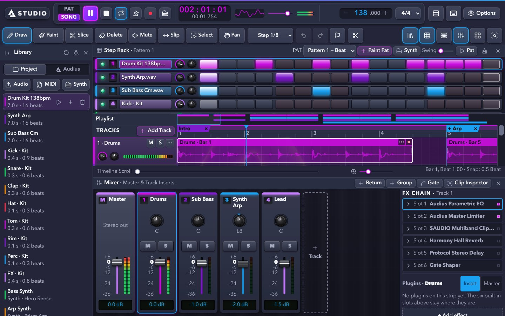
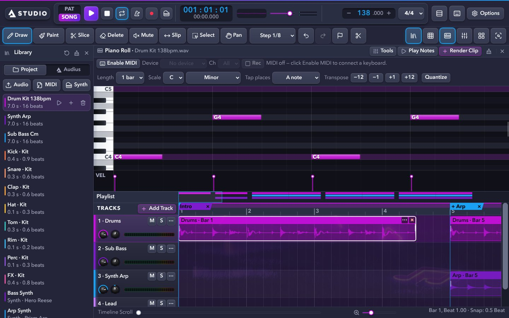
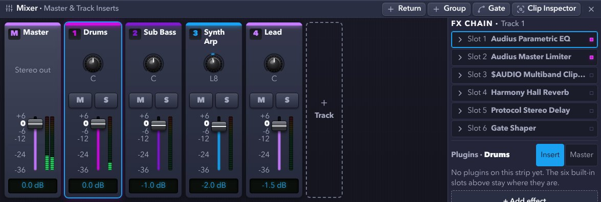
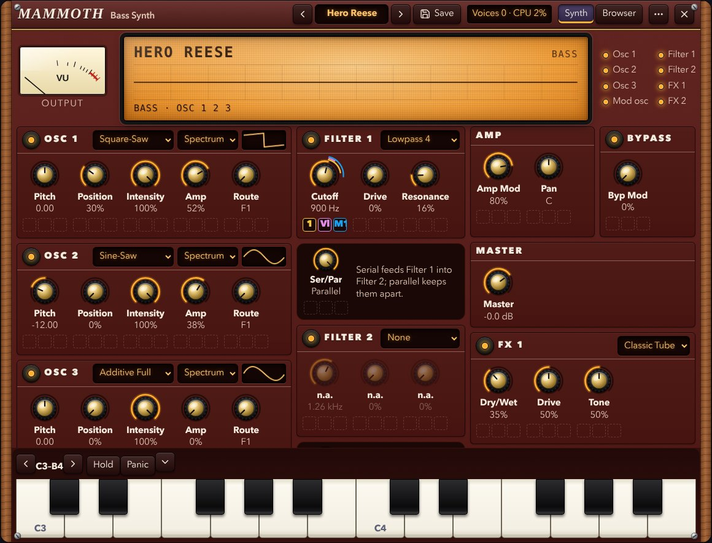
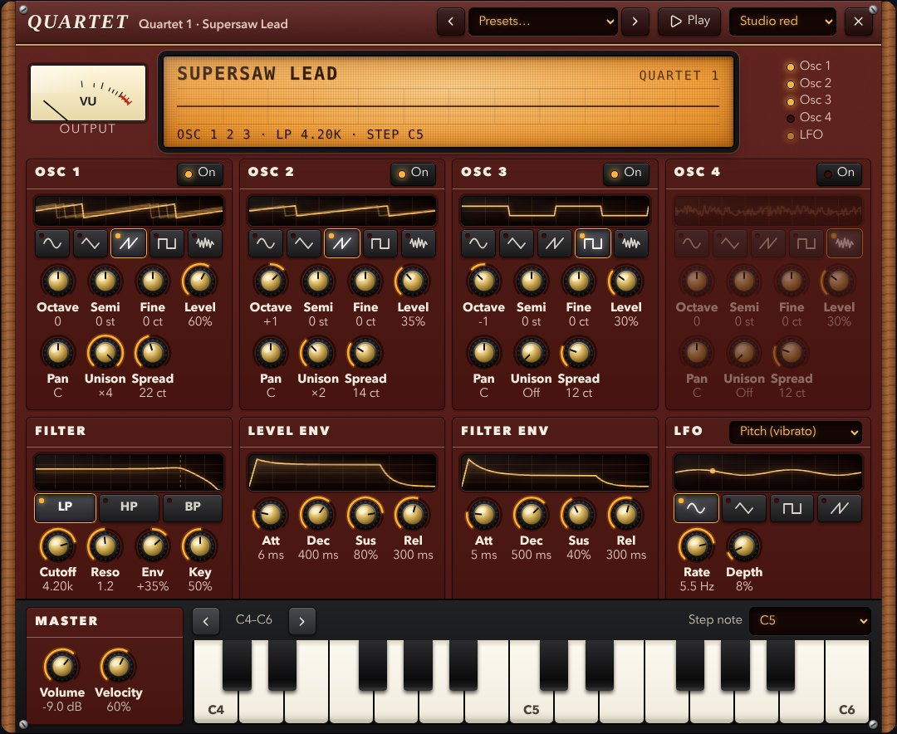
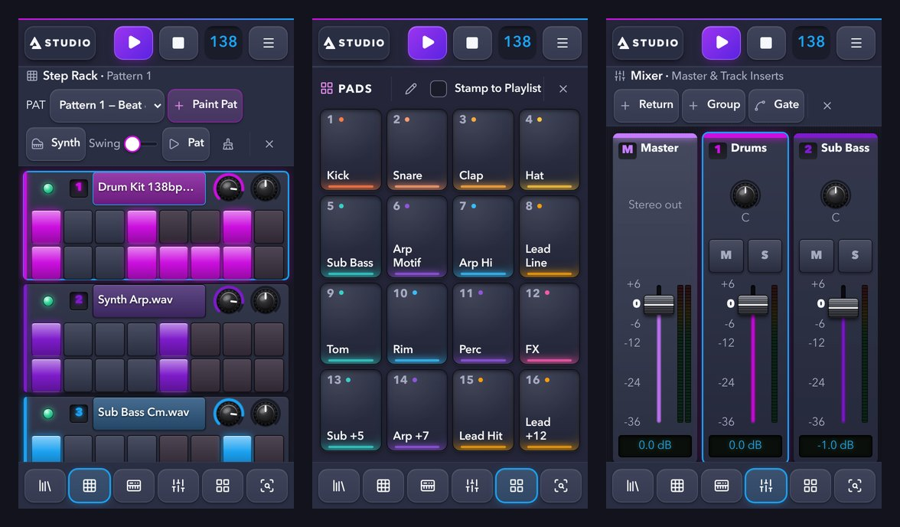
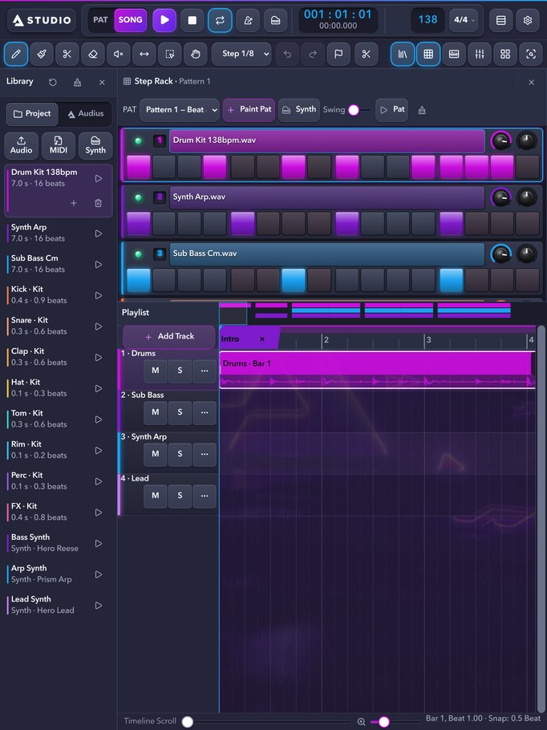

<div align="center">

# STUDIO

**A free music studio in the browser, built by and for the Audius community.**

Make beats, play synths, arrange stems, mix and export, on a desktop, a tablet or a phone.
No install, no account, no build step.

**[Open STUDIO → audius-studio.online](https://audius-studio.online)**



</div>

> STUDIO is an **unofficial, community-built** project. It is not made, owned or endorsed by Audius. It uses Audius's public API and brand assets as a fan project for the community.

---

## Contents

- [What it does](#what-it-does)
- [Screenshots](#screenshots)
- [Getting started](#getting-started)
- [Run it locally](#run-it-locally)
- [Browsers and devices](#browsers-and-devices)
- [How it is built](#how-it-is-built)
- [Project layout](#project-layout)
- [The DAW API (optional)](#the-daw-api-optional)
- [Contributing](#contributing)
- [Licence and credits](#licence-and-credits)

---

## What it does

### Make music

| Area | What you get |
|---|---|
| **Step Rack** | A drum-machine style sequencer: one row per sound, volume and pan knobs per row, swing, several patterns, and pads that light in each channel's colour. Drag across a row to paint steps; on a touchscreen, swipe sideways. |
| **Piano Roll** | Draw notes on a full keyboard with velocity, quantize, transpose, chords, scales (notes outside the scale are flagged) and patterns up to 8 bars. Notes take the channel's colour. |
| **Pads** | 16 backlit pads for finger drumming, with a per-pad sound editor (start and end, pitch, gain, attack, release, reverse and hold). Hits can be stamped straight onto the Playlist. |
| **Synths** | **Mammoth**: a wavetable synth with 3 wavetable oscillators, two filters, envelopes, LFOs, macros and 33 presets. **Quartet**: a four-oscillator synth with 11 presets. Both have a hardware-style panel with a centre display, and three looks. |
| **Sampler** | Load **SoundFont (.sf2)** and **SFZ** instruments and play them like any other channel. |
| **Drum kit** | A built-in kit (kick, snare, clap, hat, tom, rim, perc, FX) is always there. |
| **Recording** | Record from a microphone or line input, with a count-in and latency compensation. |
| **MIDI** | Play and record with a USB MIDI keyboard (Chrome and Edge), use the computer keyboard as a piano, or connect an LMN-3 controller. Import and export `.mid` files. |

### Arrange and edit

- **Playlist** with tracks and clips: draw, paint, slice, slip, mute, select and delete tools, snap to the grid, markers and loop region.
- **Linked pattern clips**: edit a pattern once and every copy in the Playlist follows.
- **Clip Inspector**: gain, pitch and pan knobs, fades, reverse, quick slicing (by bar, beat, 1/8 or detected transients) and tempo-following (warp) for audio.
- **Tempo changes**, any **time signature**, crossfades between overlapping clips, **automation lanes**, and **freeze / bounce** of a track to audio.
- **Undo and redo** for every edit.

### Mix

- A **mixer console**: a strip per track with pan knob, mute and solo, a metal fader on a dB scale and an LED meter, plus return and group buses and sidechain ducking.
- Each track has an **EQ** and **FX slots**: parametric EQ, limiter, multiband clipper, reverb, delay and a Gate Shaper. Effects plugins can be added on top: Aurora Reverb, Echo Line, Sweep Filter, Silk Chorus, Orbit Phaser and Punch Compressor ship with the app.
- **Bring your own effects**: any effect compiled to WebAssembly can be loaded as a plugin (`.js` + `.wasm`); see [`tools/wasm-plugins/README.md`](tools/wasm-plugins/README.md).
- **Track LFOs** move a track's volume or pan in time with the song.

### Import, save and share

- Import **WAV, MP3, FLAC, OGG, M4A, AAC and WebM** stems by file picker or drag and drop.
- **Browse Audius** inside the app: preview tracks, and import the tracks and stems their artists made downloadable.
- **Export** the mix or every track as separate stems: WAV (16, 24 or 32-bit float, 44.1 or 48 kHz) or MP3 (320 or 192 kbps), and the notes as MIDI.
- **Publish to Audius**: STUDIO saves your MP3 and opens Audius's upload page, where you sign in and post it.
- **Projects save themselves** in your browser (with their audio) and reopen where you left off. Save and Open keep named projects, and a project can be downloaded as a `.dawproj.json` file.
- **Defaults**: save your favourite theme, wallpaper, synth look, snap, tool and zoom as your default, restore it, or go back to the built-in settings.
- **Installable** as an app on a phone, tablet or computer, and opens offline once loaded.

### Looks

Nine colour themes in the Audius palettes (Signature Dark, Neue Dark, Day, Matrix and more), Audius wallpapers, custom accent and background colours, and three synth looks (Studio red, Vintage black, Silver).

---

## Screenshots

<table>
<tr>
<td width="50%"><br><sub><b>Piano Roll</b>: a real keyboard, notes in the channel's colour, the scale shaded.</sub></td>
<td width="50%"><br><sub><b>Mixer</b>: console strips with faders, LED meters and the FX chain.</sub></td>
</tr>
<tr>
<td><br><sub><b>Mammoth</b>: wavetable synth with a centre display, in the Studio red look.</sub></td>
<td><br><sub><b>Quartet</b>: four oscillators, a filter, envelopes and an LFO.</sub></td>
</tr>
</table>

**On a phone**: every window gets the whole screen, switched from the tab bar at the bottom, with 44px touch targets throughout.



**On a tablet**: the Step Rack puts its steps on a full-width line so every pad is thumb-sized.



---

## Getting started

1. Open **[audius-studio.online](https://audius-studio.online)**. The first visit loads a demo session (138 BPM) so there is something to play with straight away.
2. Press **Play** (or the Space bar).
3. Open windows from the buttons at the top right, or on a phone from the tab bar: **Library**, **Step Rack**, **Piano Roll**, **Mixer**, **Pads** and **Inspector**.
4. Add your own sounds with **Audio** in the Library, a synth with **Synth**, or browse **Audius**.
5. When you are done, **Options → Export Track** saves a WAV or MP3.

Keyboard shortcuts are listed under **Options → Keyboard Shortcuts** (or press `F1`). Familiar ones: `F5` Playlist, `F6` Step Rack, `F7` Piano Roll, `F9` Mixer, Space to play and stop, `Ctrl+Z` to undo.

---

## Run it locally

STUDIO is plain HTML, CSS and JavaScript modules in [`app/public`](app/public). There is nothing to build: serve that folder with any static web server.

```sh
git clone https://github.com/DOGECOIN87/DAW.git
cd DAW/app/public
python3 -m http.server 8080
# then open http://localhost:8080
```

Or, with Node.js 18 or later, run the local server, which also hosts the optional [DAW API](#the-daw-api-optional):

```sh
npm install   # only needed for the test tools
npm start     # http://localhost:3000
```

Audio needs a click or tap before it starts, as in every browser.

---

## Browsers and devices

STUDIO is designed **touch-first** and tested on screens from a 360px-wide phone to 4K monitors.

| Browser | Support |
|---|---|
| Chrome, Edge, Brave, Samsung Internet (version 95 and later) | Full, including USB MIDI keyboards |
| Safari on iPhone, iPad and Mac (14 and later) | Full, except USB MIDI (Safari has no Web MIDI) |
| Firefox | Works, except USB MIDI |

Older devices matter here: the project owner tests on a Galaxy Note 3 (about Chrome 95) and older iPads, so the code avoids newer CSS and JavaScript features that those browsers lack.

---

## How it is built

- **No framework, no build step.** Vanilla ES modules, one stylesheet and an inline SVG icon sprite. What is in `app/public` is exactly what is deployed.
- **Web Audio** for the engine: mixing, effects and offline rendering for export. The synths run in **AudioWorklets**; user effect plugins are WebAssembly.
- **Canvas** for the Playlist, Piano Roll, waveforms and synth displays; the rest is HTML and CSS.
- **IndexedDB** keeps imported audio and the autosaved session in the browser; `localStorage` keeps settings.
- **Static hosting** on Cloudflare Pages: pushing to `main` deploys `app/public` to [audius-studio.online](https://audius-studio.online). There is no server in production and no account system.

---

## Project layout

```
app/public/          the app (deployed as-is)
  index.html         the page and its windows
  app.js             the main controller: playlist, windows, mixer, projects
  audio-engine.js    the real-time and offline audio engine
  styles.css         all styles and themes
  instruments/       Mammoth, Quartet and the SoundFont/SFZ sampler, plus shared synth UI parts
  plugins/           built-in effects and the WebAssembly effect driver
  midi-*.js          MIDI files, MIDI input and the LMN-3 controller
app/server.mjs       optional local server (static files + DAW API)
app/api/             the DAW API: HTTP router, WebSocket bridge, MCP server
tools/               plugin build tools, deploy checks, test scripts
docs/                design notes, screenshots and the design-pass test harness
test/                API smoke tests
```

---

## The DAW API (optional)

When STUDIO runs from the local server (`npm start`) with one browser tab open, the whole workstation can also be driven over HTTP: 56 operations covering the session, transport, tracks, playlist editing, mixer, markers, undo and export. It is also available as a command-line tool and an MCP server. See [`app/api/README.md`](app/api/README.md).

```sh
curl -s -X POST http://127.0.0.1:3000/api/call -H 'content-type: application/json' \
  -d '{"op":"exportWav","args":{"mode":"master","bitDepth":24}}'
```

The API is a local tool only; the public site has no server.

---

## Contributing

Ideas, bug reports and pull requests from the community are welcome.

1. Fork the repository and create a branch.
2. Serve `app/public` locally (see above) and make your change.
3. Check it on a narrow phone width and a desktop width. Browser tests use Playwright through [`docs/design-pass/harness/lib.cjs`](docs/design-pass/harness/lib.cjs), and `npm run test:api` checks the API.
4. Open a pull request describing what changed and why.

A few house rules keep STUDIO working for everyone:

- **Older browsers must keep working.** In CSS, avoid `@layer`, `color-mix()`, `oklch()`, `:has()`, container queries, nesting and `@property` unless there is a complete fallback. In JavaScript, avoid `structuredClone` and `findLast`.
- **Readable and touchable.** Text is at least 15px, touch targets are at least 44×44px, and nothing scrolls the page sideways.
- **Cache-busting.** When `styles.css` or `app.js` changes, bump their `?v=` numbers in `index.html`; when another module changes, bump the version in the URL that imports it.
- **Unofficial means unofficial.** Never describe STUDIO as official or as made, owned or endorsed by Audius, and never use other companies' product names, logos or artwork in the app.
- **Your own code.** Only contribute code you wrote or code under a compatible open licence, credited in [`THIRD_PARTY_NOTICES.md`](THIRD_PARTY_NOTICES.md).

---

## Licence and credits

STUDIO's licence is being finalised. Until a `LICENSE` file is published here, the code is © its author with all rights reserved, and using STUDIO at [audius-studio.online](https://audius-studio.online) stays free. For licensing or partnership enquiries, open an issue in this repository.

Some things in this repository belong to others and keep their own terms:

- **Audius logos, `$AUDIO` and tier artwork, and wallpapers** (`app/public/assets/audius/`) belong to Audius and are used under the [Audius brand guidelines](https://brand.audius.co/).
- **Avenir Next LT Pro** (the Audius Harmony typeface in `app/public/audius-fonts.css`) is a commercial Linotype/Monotype design, redistributed by Audius for Audius-branded use.
- **Lucide icons** (ISC), **Audius Harmony colour values** (ISC / Apache-2.0) and other third-party material are credited in [`THIRD_PARTY_NOTICES.md`](THIRD_PARTY_NOTICES.md).

Thanks to the Audius community for the inspiration, and to everyone who tries STUDIO and sends feedback.
